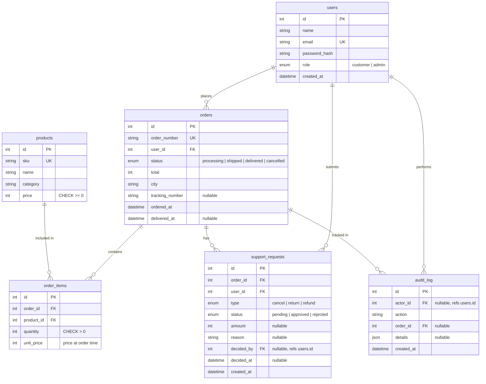

# ShopAssist Database Schema

> [!IMPORTANT]
> This doc is manually maintained. If you change `app/db/models.py`, update this file too.

## Entity-Relationship Diagram



## Table Details

### 1. `users`

| Column | Type | Constraints | Description |
|---|---|---|---|
| `id` | INTEGER | **PRIMARY KEY** | Auto-increment ID |
| `name` | VARCHAR(100) | NOT NULL | Full name |
| `email` | VARCHAR(255) | **UNIQUE**, indexed | Login email |
| `password_hash` | VARCHAR(255) | NOT NULL | Argon2 hash |
| `role` | VARCHAR(20) | CHECK: `customer` or `admin` | User role |
| `created_at` | DATETIME(tz) | DEFAULT now() | Account creation time |

### 2. `products`

| Column | Type | Constraints | Description |
|---|---|---|---|
| `id` | INTEGER | **PRIMARY KEY** | Auto-increment ID |
| `sku` | VARCHAR(32) | **UNIQUE** | Stock Keeping Unit code |
| `name` | VARCHAR(200) | NOT NULL | Product name |
| `category` | VARCHAR(100) | NOT NULL | Category (Audio, Mobile, etc.) |
| `price` | INTEGER | CHECK: `>= 0` | Price in whole rupees |

### 3. `orders`

| Column | Type | Constraints | Description |
|---|---|---|---|
| `id` | INTEGER | **PRIMARY KEY** | Auto-increment ID |
| `order_number` | VARCHAR(20) | **UNIQUE**, indexed | Display number (ORD1001) |
| `user_id` | INTEGER | **FK → users.id**, indexed | Who placed the order |
| `status` | VARCHAR(20) | CHECK: processing/shipped/delivered/cancelled | Current status |
| `total` | INTEGER | NOT NULL | Total amount in rupees |
| `city` | VARCHAR(100) | NOT NULL | Delivery city |
| `tracking_number` | VARCHAR(50) | nullable | Courier tracking ID |
| `ordered_at` | DATETIME(tz) | NOT NULL | When order was placed |
| `delivered_at` | DATETIME(tz) | nullable | When delivered (if delivered) |

### 4. `order_items`

| Column | Type | Constraints | Description |
|---|---|---|---|
| `id` | INTEGER | **PRIMARY KEY** | Auto-increment ID |
| `order_id` | INTEGER | **FK → orders.id** (CASCADE delete), indexed | Parent order |
| `product_id` | INTEGER | **FK → products.id** | Which product |
| `quantity` | INTEGER | CHECK: `> 0` | How many units |
| `unit_price` | INTEGER | NOT NULL | Price at time of order (frozen) |

> [!NOTE]
> `unit_price` is stored separately from `products.price` so that if a product's price changes later, historical orders still show what the customer actually paid.

### 5. `support_requests`

| Column | Type | Constraints | Description |
|---|---|---|---|
| `id` | INTEGER | **PRIMARY KEY** | Auto-increment ID |
| `order_id` | INTEGER | **FK → orders.id**, indexed | Related order |
| `user_id` | INTEGER | **FK → users.id**, indexed | Customer who filed it |
| `type` | VARCHAR(20) | CHECK: cancel/return/refund | Request type |
| `status` | VARCHAR(20) | CHECK: pending/approved/rejected | Current status |
| `amount` | INTEGER | nullable | Refund amount (if applicable) |
| `reason` | TEXT | nullable | Customer's reason |
| `decided_by` | INTEGER | **FK → users.id**, nullable | Admin who decided |
| `decided_at` | DATETIME(tz) | nullable | When decision was made |
| `created_at` | DATETIME(tz) | DEFAULT now() | When request was filed |

### 6. `audit_log`

| Column | Type | Constraints | Description |
|---|---|---|---|
| `id` | INTEGER | **PRIMARY KEY** | Auto-increment ID |
| `actor_id` | INTEGER | **FK → users.id**, nullable | Who did it (null = system) |
| `action` | VARCHAR(50) | NOT NULL | What happened |
| `order_id` | INTEGER | **FK → orders.id**, nullable | Related order |
| `details` | JSON | nullable | Extra info as JSON |
| `created_at` | DATETIME(tz) | DEFAULT now() | When it happened |

## How Tables Are Linked (Foreign Keys)

```
users.id  ←──  orders.user_id              (one user → many orders)
users.id  ←──  support_requests.user_id    (one user → many requests)
users.id  ←──  support_requests.decided_by (one admin → decides many requests)
users.id  ←──  audit_log.actor_id          (one user → many audit entries)

orders.id ←──  order_items.order_id        (one order → many items, CASCADE delete)
orders.id ←──  support_requests.order_id   (one order → many support requests)
orders.id ←──  audit_log.order_id          (one order → many audit entries)

products.id ←── order_items.product_id     (one product → many order items)
```
